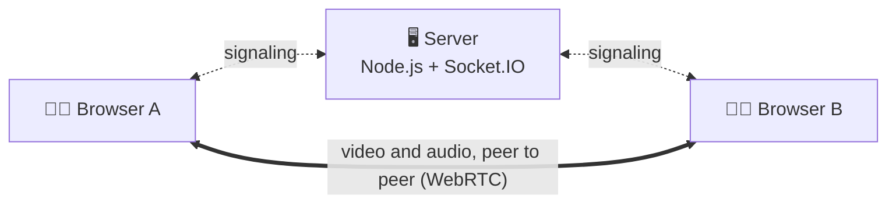

**👋 Hi! I'm a developer from Mexico City. I build complete projects, and years later I rebuild them to see how far I've come.**

Several of my repositories hold the same project twice. **v1** is what I wrote when I started, with only its bugs fixed. **v2** is the rewrite: better design, automated tests, CI on every pull request, and docs that explain the decisions and their trade-offs. Both are kept, so you can see what I learned in between.

🎧 **Try two of my apps now, no install:** [Jossify](https://jossify-joss.web.app/demo) · [Study Partner](https://simple-video-chat-rpq1.onrender.com)

---

## 🚀 Featured projects

### 🔎 [AlgoScope](https://github.com/Josafath/Sorting-Algorithms): algorithms you can watch, step by step

Six sorting algorithms on bars, and BFS, DFS, Dijkstra and A* finding their way through a maze you can draw. Play, pause, or step **backwards**.

- Each algorithm is recorded once and then replayed, so stepping back is just an undo. The algorithms stay plain code: no threads, no sleeps.
- **344 tests**, including the UI without a screen (colors checked pixel by pixel, simulated mouse drags). CI on Windows, macOS and Linux.
- One finding in the docs: a single tie-break rule makes A* explore **59 cells instead of 900**.

`Java 21` · `Swing` · `no dependencies` · [How it's built](https://github.com/Josafath/Sorting-Algorithms/blob/master/v2/docs/ARCHITECTURE.md)

### 🎧 [Jossify](https://github.com/Josafath/Spotify-React-App): your Spotify listening, ranked · [**live demo**](https://jossify-joss.web.app/demo)

Your top tracks and artists over the last 4 weeks, 6 months and all time, and how they climb or drop between those ranges.

- Sign-in with OAuth 2.0 + PKCE and token refresh, fully in the browser, with no backend.
- A demo mode with fictional data, so anyone can try it without a Spotify account.
- Keyboard and screen-reader friendly, respects reduced motion, WCAG AA contrast.

`React 19` · `TypeScript` · `TanStack Query` · `Vitest` · `Firebase Hosting`

### 📹 [Study Partner](https://github.com/Josafath/simple-video-chat): one-to-one video chat for studying · [**live demo**](https://simple-video-chat-rpq1.onrender.com)

Create a private room, send the invite link, and talk with video, audio and text chat.

- Video goes straight between the two browsers with WebRTC; the server only introduces them (signaling).
- Private rooms behind 128-bit invite links, passwords hashed with bcrypt.
- An end-to-end test makes **a real call between two headless Chrome sessions**. CI on Node 20, 22 and 24.

`Node.js` · `Express` · `Socket.IO` · `WebRTC` · `MongoDB`

### 🧑‍🏫 [RollCall](https://github.com/Josafath/attendance-management): class attendance with face recognition

Point the webcam at the class: it recognizes each student and marks them present.

- Each face becomes 128 numbers, compared by cosine similarity. A student counts as present only after **5 of 8 frames** agree.
- It stores **no photos**, only those numbers.
- **143 tests**, CI on Windows, macOS and Linux. v1 needed four packages; v2 only OpenCV and NumPy.

`Python` · `OpenCV (YuNet + SFace)` · `Tkinter` · `SQLite`

### Also rewritten from v1 to v2

| Project | The interesting part | Tests |
|---|---|---|
| [AuthLab](https://github.com/Josafath/Login-Python) | Sign-up and log-in with salted PBKDF2 (600,000 iterations) and lockouts. Sorting, binary search and a trie written by hand. | 57 |
| [Rock-Paper-Scissors](https://github.com/Josafath/Rock-Paper-Scissors) | A CPU that learns your patterns with Markov chains and beats a player who cycles moves over 90% of the time. | 32 |

---

## 🧰 Tech I work with

<table>
  <tr><td><b>Languages</b></td><td></td></tr>
  <tr><td><b>Front end</b></td><td></td></tr>
  <tr><td><b>Back end</b></td><td></td></tr>
  <tr><td><b>Data</b></td><td></td></tr>
  <tr><td><b>Tools</b></td><td></td></tr>
</table>

---

## 📫 Find me

I'm open to opportunities and happy to talk about any of these projects.

